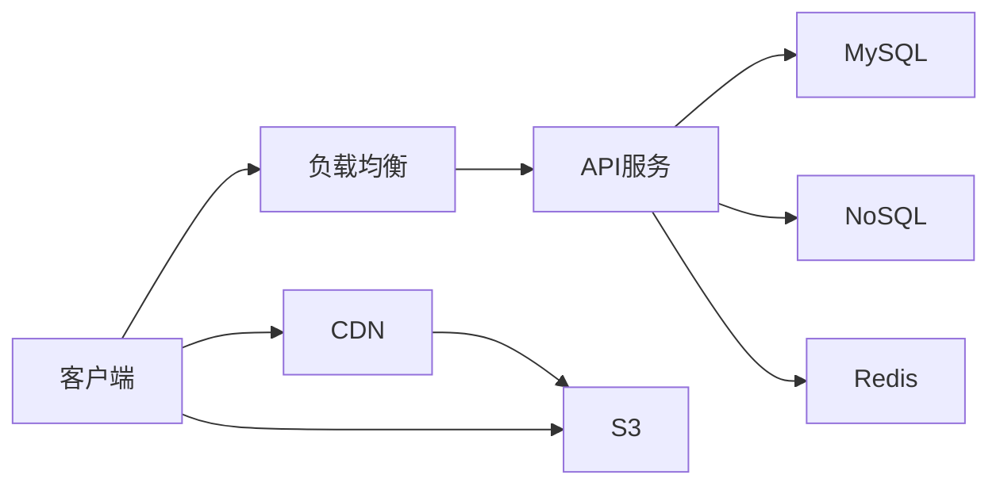

# Twitter 规模估算

> 建议限时 45 分钟，按面试顺序写。

## 1. 需求澄清（约 5 分钟）

**功能需求**
- 用户可以发布文字、图片、视频推文
- 用户可以关注其他用户
- 用户刷新首页时间线，按照时间倒序看到自己关注的人的推文

**非功能需求**（可用性、延迟、一致性、持久性）
- 规模：2e日活
- 可用性99.99%。
- 发布推文的接口 P99<200ms，时间线加载 P99 < 200ms
- 不同用户在同一时间看到的推文在5s内一致，最终一致。
- 消息不可丢，保存五年

**不做的事**（明确范围）
- 检索信息
- 私信

## 2. 规模估算（约 5 分钟）

- 用户数 / DAU：2e
- 读 QPS / 写 QPS（平均和峰值）：
    avg-create:4k qps;peak-create:1.2w
    ave-read:40w qps;peak-read:120w

    读写比：100：1
    读多写少

- 存储（每条大小 × 数量 × 保存年限）：
    - 纯文本：4e * 0.2KB * 5 * 365 = 160TB
    - 图片：6kw*2000kB * 5 * 365= 240PB
    - 视频：800w* 200000kB *5 * 365= 3EB

- 带宽：
    - 入口：
        4000 * 2MB * 15% = 1.2GB/s
        4000 * 200MB * 2 % = 16GB/s
        合计17GB/s
    - 出口：
        40w * 2MB * 15% = 120GB/S
        40w * 200MB * 2% = 1.6TB/S
        合计1.7TB/s

- 缓存估算：
    二八原则：20%的热点数据承担了80%的读请求，采取缓存最近一天的推文文本：
    日缓存文本量：80GB
    机器台数：2* 3 = 6

- 机器数（按峰值请求数，单机 1 万 QPS，×2 冗余）：
    - 读服务：时间线请求峰值 6 万 ÷ 1 万 = 6 台，×2 ≈ 12 台
    - 写服务：发推峰值 1.2 万 ÷ 1 万 ≈ 1.2 台，×2 ≈ 3 台
    - 合计约 15 台
    - 上限：如果把每条推文读取都算一次处理，120 万 ÷ 1 万 × 2 = 240 台
    Redis 读压力：峰值 120 万条推文/秒，用 MGET 批量取，单机 10 万/秒 → 约 12 台。前面按内存要 60 台，取大的，60 台够用
    Cassandra 存储：文本 5 年 150TB × 3 副本 = 450TB，每台存 4TB → 约 110 台。读请求大部分被 Redis 挡掉，所以按磁盘算就够了
    MySQL 关注表：400 亿行 × 约 20B ≈ 800GB，需要按 follower_id 分库分表，几台就够

## 3. API 设计

```
发送：
 - POST /v1/tweets
 {
    client_tweet_id:,
    content:
    media_ids:
    }
 返回：
 {
    tweet_id:
    created_at:
 }

查询：
 - GET  /v1/tweets/{id}
    返回
    {
        content:
        tweet_id:
        author:
        media_urls:
        created_at:
    }
 - GET /v1/tweets/timeline/?cursor=XX&limit=20
    返回
    {
        tweets:[
            {
                content:
                author:
                tweet_id:
                media_urls:
                created_at
            }
        ],
        next_cursor:"1857"
    }

特殊：
媒体：
 - POST /v1/media
 {
    content_type:"image/jpg", size
 }
 返回
 {
    media_id
    upload_url
 }

关注：
 - POST /v1/users/{user_id}/follow

 - DELETE /v1/users/{user_id}/follow
```

## 4. 数据模型

- 存什么，用什么存储（SQL / NoSQL / 对象存储 / 缓存），为什么：
- 用户(user)：SQL存储
    reason：数据库量小
    id
    name
    created_at
- 关注关系(follow)：SQL存储
    reason：关系型数据，两个字段各自需要一个索引
    follows(follower_id, followee_id)

- 推文(tweet)：NoSQL，可以采用cassandra
    reason：写入量大，查询方式固定
    content
    author[分区键]
    id[排序键]
    media_ids
    created_at

- 媒体文件：S3，利用CDN分发
    1.存储量大
    2.不用CDN影响带宽
- 热门推文、今天一天推文：Redis
    增加可用性，减少数据库压力，降低延迟
    timeline:{user_id} → [tweet_id, tweet_id]
    tweet:{tweet_id} → 热文推文内容


## 5. 高层架构



## 6. 深入关键组件（约 15 分钟）

挑 2 到 3 个最难的点展开：
时间线生成
**问题**：每秒2w次刷新，每个用户平均关注人数为300，怎么在200ms内拼出时间线？
**方案**：
- 推模式：发推即写入每个粉丝的时间线，但是大up主有1E粉丝，要写1亿次，需要17min，远远超过5s可见
- 拉模式：每秒查询数据库的次数为2w* 300 = 600万次，按照一台机器承担的数据库访问次数是1w/台，考虑峰值，需求1800台，每次刷新查询300次，假设一次查询1ms，则需要300ms，超过P99<200ms

**选择**：
- 推拉结合
普通用户（粉丝<10w）用推：发推时写入每个粉丝的Redis时间线
大V(粉丝>=10w)用拉：发推不扩散，读的时候再查
阈值：可接受的延迟 × 每秒写入能力= 5 秒 × 10 万/秒 = 50 万。取余量为10w
刷新时间线：
    - 从Redis获取推过来的时间线
    - 拉一下关注的几个大V最新推文
    - 两份结果合并，按时间倒序取前20条返回。

**代价**：
- 推模式给每个粉丝的时间线存一份ID，内存4TB，存储redis大概需要60台，写入需要4kqps * 300粉丝 = 120万次/秒，峰值 360万次/秒
- 读的时候要额外查大V的推文再合并，多了查询、代码有两条路径更复杂
- 大V的推文会被几千万人同时读，成为热点，需要单独缓存

媒体上传

**问题**：
入口带宽17GB/s，如果都经过API服务，需要大量服务器只做[搬文件]，17GB/s ÷ 每台网卡 1.25GB/s ≈ 14 台，留余量后要 20 多台机器只为搬文件。

**方案**：
    - 经过API服务中转;
    - 预签名url直传

**选择**：
    - 预签名url，客户端直传OSS

**代价**：
    - 不能边传边检查，要在签发URL时限制类型和大小，传完异步审核，发推时再校验
    - 会产生孤儿文件，需要定时清理


-

## 7. 扩展与瓶颈

- 单点故障在哪里，怎么解决：
    - 无状态，不存任何数据：多台+负载均衡
    - 有状态，存在数据：多副本+自动切换
- 数据怎么分片：
    采取author分片
- 缓存策略：
    时间线最多800条，推文缓存用LRU+TTL
- 热点问题：
    大V的推文多份缓存+本地缓存

## 8. 取舍总结

| 决定 | 选择 | 代价 | 收获 |
|------|------|-----------| ---- |
|时间线缓存长度      | 最多800条     | 翻到40页以后要回源，速度会慢  | 内存固定在约4TB，可规划 |
|  一致性  | 最终一致  | 发推后粉丝不能立刻看到，最多晚5s |  发推可以异步，立刻返回；可用性高 | 
| 时间线生成 | 推拉模式 | 两套逻辑，读时需要合并，4TB的内存 | 刷新只读一个Redis Key，读很快；大V不会拖垮写入 |
| 推文存储 | NoSQL | 不能join，只能按分区建查，不能按任意字段查| 写入量大页扛得住，加机器就能水平扩展 |
| 媒体上传 | 预签名 URL 直传 OSS | 需要异步审核；孤儿文件 | 大文件不经过API服务器，剩下20多台做搬文件的机器 |
