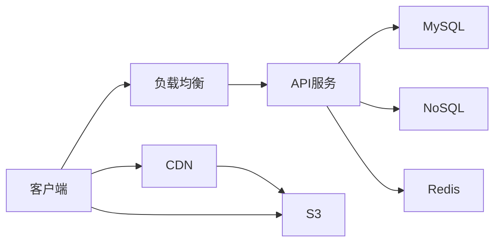

# Twitter 规模估算

> 建议限时 45 分钟，按面试顺序写。

## 1. 需求澄清（约 5 分钟）

**功能需求**
- 用户可以发布文字、图片、视频推文
- 用户可以关注其他用户
- 用户刷新首页时间线，按照时间倒叙看到自己关注的人的推文

**非功能需求**（可用性、延迟、一致性、持久性）
- 规模：2e日活
- 可用性99.99%。
- 发布推文的接口 P99<200ms
- 不同用户在同一时间看到的推文在4s内一致，最终一致。
- 消息不可丢，保存五年

**不做的事**（明确范围）
- 检索信息
- 私信

## 2. 规模估算（约 5 分钟）

- 用户数 / DAU：2e
- 读 QPS / 写 QPS（平均和峰值）：
    avg-create:4k qps;peak-create:1.2w
    ave-read:40w qps;peak-read:120w

    读写比：100：1
    读多写少

- 存储（每条大小 × 数量 × 保存年限）：
    - 纯文本：4e * 0.2KB * 5 * 365 = 160TB
    - 图片：6kw*2000kB * 5 * 365= 240PB
    - 视频：800w* 200000kB *5 * 365= 3EB

- 带宽：
    - 入口：
        4000 * 2MB * 15% = 1.2GB/s
        4000 * 200MB * 2 % = 16GB/s
        合计17GB/s
    - 出口：
        40w * 2MB * 2% = 120GB/S
        40w * 200MB * 15% = 1.6TB/S
        合计1.7TB/s

- 缓存估算：
    二八原则：20%的热点数据承担了80%的读请求，采取缓存最近一天的推文文本：
    日缓存文本量：80GB
    机器台数：2* 3 = 6

- 机器数：
    - 入口：120/ 1w * 3 = 360台

## 3. API 设计

```
发送：
 - POST /v1/tweets
 {
    client_tweet_id:,
    content:
    media_ids:
    }
 返回：
 {
    tweet_id:
    created_at:
 }

查询：
 - GET  /v1/tweets/{id}
    返回
    {
        content:
        tweet_id:
        author:
        media_urls:
        created_at:
    }
 - GET /v1/tweets/timeline/?cursor=XX&limit=20
    返回
    {
        tweets:[
            {
                content:
                author:
                tweet_id:
                media_urls:
                created_at
            }
        ],
        next_cursor:"1857"
    }

特殊：
媒体：
 - POST /v1/media
 {
    content_type:"image/jpg", size
 }
 返回
 {
    media_id
    upload_url
 }

关注：
 - POST /v1/users/{user_id}/follow

 - DELETE /v1/users/{user_id}/follow
```

## 4. 数据模型

- 存什么，用什么存储（SQL / NoSQL / 对象存储 / 缓存），为什么：
- 用户(user)：SQL存储
    reason：数据库量小
    id
    name
    created_at
- 关注关系(follow)：SQL存储
    reason：关系型数据，两个字段各自需要一个索引
    follows(follower_id, followee_id)

- 推文(tweet)：NoSQL，可以采用cassandra
    reason：写入量大，查询方式固定
    content
    author[分区键]
    id[排序键]
    media_ids
    created_at

- 媒体文件：S3，利用CDN分发
    1.存储量大
    2.不用CDN影响带宽
- 热门推文、今天一天推文：Redis
    增加可用性，减少数据库压力，降低延迟
    timeline:{user_id} → [tweet_id, tweet_id]
    tweet:{tweet_id} → 热文推文内容


## 5. 高层架构



## 6. 深入关键组件（约 15 分钟）

挑 2 到 3 个最难的点展开：

-

## 7. 扩展与瓶颈

- 单点故障在哪里，怎么解决：
- 数据怎么分片：
- 缓存策略：
- 热点问题：

## 8. 取舍总结

| 决定 | 选择 | 放弃了什么 |
|------|------|-----------|
|      |      |           |
